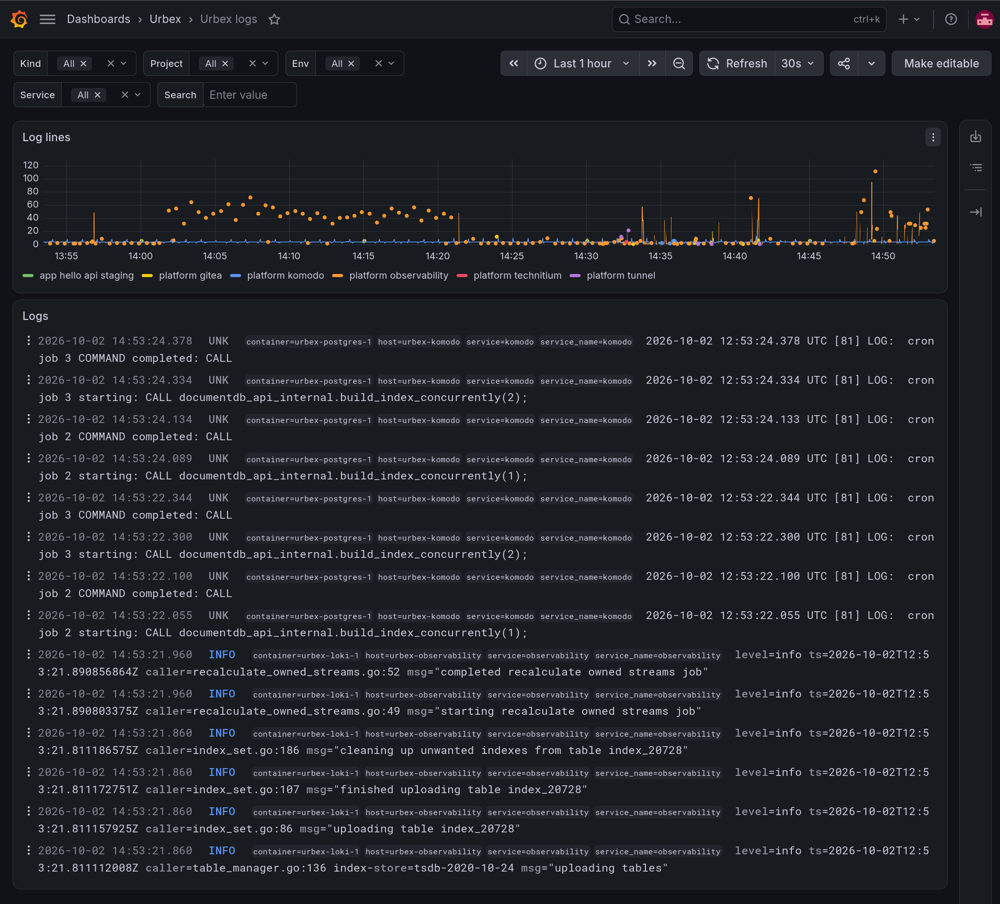

# Urbex

**Urbex - a self-hosted app platform: everything your apps need, on infrastructure you own.**

Write the app; Urbex gives it everything else - repositories, builds, deploys, login, networking, logs, backups. On your server, not someone else's cloud.

Every environment, from a homelab to the cloud, should give applications the same fundamental services, the same way. Urbex is that platform.

> **Status: working prototype, not released yet.** The whole flow - from an
> empty Proxmox node to an app in staging and production - runs end to end
> and has been validated on a real server. The CLI's repository isn't
> public yet: it will be, as open source, with the first release. Watch
> this repository to hear about it.

## Who it's for - today

**You have a Proxmox node** - a homelab, a server at home or in a rack -
and **a domain**, and you want your apps on it the way a company would
run them: staging and production, builds on every push, releases you
promote, login, logs and metrics, secrets that are never in plain text,
admin tools that aren't open to the internet. Without wiring all of it by
hand, and with an AI agent able to drive it: "deploy to staging",
"promote to production".

**Not yet for you if** you don't want to own a server: if "deploy" should
just work, on a cloud you don't manage, wait for cloud VM support - it's
on the [roadmap](docs/roadmap.md), and it's what opens Urbex to anyone
who builds apps, vibe coders included.

## What it looks like

```sh
urbex bootstrap            # once: the platform's services on your Proxmox node
urbex init                 # in your app's repo: describe it in urbex.yaml
urbex apply staging        # its staging environment; every push to main lands there
urbex apply prod           # once: its production environment
urbex release              # tag what staging runs
urbex promote              # production runs the very images staging ran
```

Each of these is a single command an agent like Claude Code or Codex can
run for you. A short video of the whole flow is coming; meanwhile,
[Getting started](docs/getting-started.md) shows every command and what
it prints. And this is what you see in Grafana - the logs of every
service, the platform's and your apps':



## Why

Every serious application needs the same things: a repository, a CI
pipeline that builds its images, a CD pipeline that takes them to
staging and production, an identity provider, an address people can
reach, logs and monitoring, storage and backups, disaster recovery, high
availability. Today whoever writes the app wires each of them by hand,
and differently in every environment. Urbex is one standard ecosystem
you install once - on your homelab or your cloud - and from then on each
application declares what it needs in `urbex.yaml`, and gets it.

## An operating system for your apps

Think of it as an operating system for applications: what an OS gives a program, Urbex gives an application.

| An OS gives a program | Urbex gives an application | Today |
| --- | --- | --- |
| `exec` | build and deploy: CI builds the image, CD takes it to staging and production | available |
| processes | an isolated environment per service (LXC), staging and production | available |
| users and permissions | an identity provider (Keycloak): login, roles, a client per frontend | available |
| network and DNS | internal DNS, a public tunnel, protected access (Cloudflare) | available |
| filesystem | storage, databases, backups | roadmap |
| system logs and monitor | logs and resources in Grafana, every container in Komodo | available |
| package manager | the platform's standard services, the same in every environment | available |
| system restore | disaster recovery and high availability | roadmap |

In short: like Heroku or Vercel, but on your server and with everything
included; like Coolify or Dokploy, with identity, observability - and,
next, backups and disaster recovery - built in. And built to be driven
by an AI agent as well as by a person: its interface is a CLI an agent
like Claude Code or Codex can use
([ADR-0001](docs/decisions/0001-cli-first-interface.md)).

## How it works

Urbex runs on a server you already have - a Proxmox node today - and
installs the platform's services there: Gitea for the repositories,
Komodo for builds and deploys, Technitium for internal DNS, Keycloak for
identity, Prometheus, Loki and Grafana for monitoring, and Cloudflare for
public access. A project - web frontends deployed to Cloudflare Workers,
mobile apps registered with Keycloak, services in Java, Python, Go or any
Docker image - describes itself in `urbex.yaml`, and the `urbex` CLI
creates and keeps what it needs in every environment.

## What works today

The `urbex` CLI implements it: bootstrap
sets up Gitea and Komodo; projects are developed trunk-based, and every
push to `main` is built by Komodo and deployed to staging; releases are
tags, promoted to production; and each environment runs what its folder
in the GitOps repo says - version, configuration, SOPS-encrypted
secrets - deployed by Komodo on every change. With Cloudflare, public
APIs go out through a Cloudflare Tunnel, web frontends are deployed to
Cloudflare Workers, Keycloak is public, and Gitea and Komodo sit behind
Cloudflare Access; every service also gets an internal DNS name in
Technitium, independently of Cloudflare. Validated on a real Proxmox
VE 9.2 node and Cloudflare account - see
[`docs/known-limitations.md`](docs/known-limitations.md) for what's
still missing.
See [`docs/status.md`](docs/status.md) for the full
supported/not-supported breakdown and implementation priorities, and
`docs/` more generally for architecture, decisions, and roadmap.

## v1 — goal

- Infrastructure target: an already-running **Proxmox** server.
- Every project service runs in a dedicated **LXC** (Debian 13), as a
  container Komodo builds from the project's Git repo and rolls out.
- Platform services (created on-demand if missing):
  - **Gitea** — self-hosted Git server (app repos + GitOps repo).
  - **Komodo** — build/update pipeline and LXC management.
  - **Technitium DNS** — internal name resolution between services.
  - **Keycloak** — identity provider (SSO for admin tools and OIDC for
    apps).
  - **Prometheus + Grafana + Loki** — metrics, logs, and observability.
- All infrastructure is declared and versioned in a **GitOps repo**,
  which also says, per environment, what each project runs: version,
  configuration, secrets.
- Main interface: a **CLI** (`urbex`), designed to be driven by an LLM in a
  terminal, but also usable by a human.
- The public domain is **configurable**, not hardcoded: Urbex must be
  usable by anyone with their own Proxmox and their own domain.
- Optional transactional email via a managed provider (**Brevo** in v1,
  more planned) — no self-hosted mail server.

## Future evolutions (v2+)

- Cloud providers beyond Proxmox: Azure, GCP, AWS.
- Git servers beyond Gitea: GitHub, GitLab.
- Secrets management: optional HashiCorp Vault support alongside SOPS+age.

## Try it early, tell us what's missing

Urbex is meant to be free and open source, for everyone - it isn't a
product we sell. What we need most now are the people it's for: if you
run a homelab and would try it on yours, or if you help people take their
apps to production and see what's missing, open an
[issue](https://github.com/urbforge/urbex/issues) - what you would
deploy, what stops you, what you'd expect it to do. It shapes the
roadmap.

## Repositories

- [`urbforge/urbex`](https://github.com/urbforge/urbex) (this repo) —
  architecture, ADRs, manifest spec/schema, roadmap.
- `urbforge/urbex-cli` — the `urbex` CLI implementation (Go); not public
  yet, published with the first release. See
  [ADR-0016](docs/decisions/0016-cli-repo-split.md).

## Documentation

Start here:

- [**Getting started**](docs/getting-started.md) — from an empty Proxmox
  server to a service in production, every command and its output.
- [**Cookbook**](docs/cookbook.md) — recipes: releasing, rolling back,
  pinning staging, secrets, adding services, troubleshooting, driving
  Urbex from an LLM agent.

Reference ([index](docs/reference/)):

- [CLI](docs/reference/cli.md) — every command and flag.
- [Manifest](docs/reference/manifest.md) — `urbex.yaml`, field by field;
  formal schema in [`schemas/urbex.schema.json`](schemas/urbex.schema.json).
- [Platform config](docs/reference/platform-config.md) —
  `urbex.platform.yaml`.
- [GitOps repo](docs/reference/gitops-repo.md) — layout, version,
  configuration and secrets files, how a commit is deployed.
- [Credentials](docs/reference/credentials.md) — every credential and how
  to get it.
- [Platform resources](docs/reference/platform-resources.md) — what Urbex
  creates on Proxmox, Gitea, and Komodo.

Design and planning:

- [`docs/architecture.md`](docs/architecture.md) — components and flows.
- [`docs/decisions/`](docs/decisions/) — Architecture Decision Records.
- [`docs/status.md`](docs/status.md) — what's supported today vs. not
  yet, and priorities.
- [`docs/known-limitations.md`](docs/known-limitations.md) — every known
  limitation, with what to do meanwhile.
- [`docs/roadmap.md`](docs/roadmap.md) — v1 vs v2+ scope.
