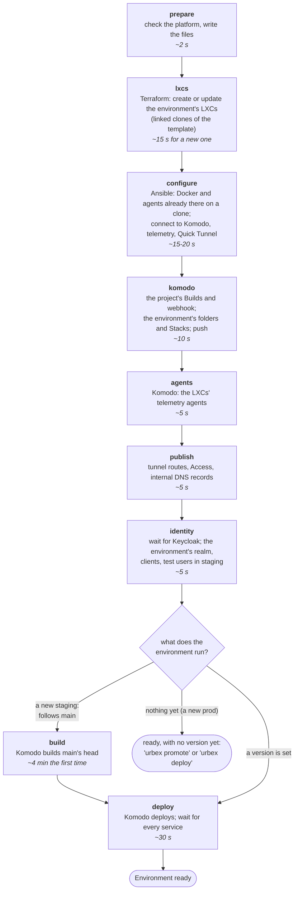

# Startup sequence: `urbex bootstrap` and `urbex apply`

What the two commands that create things do, in order, what runs at the
same time, and how long each phase usually takes. While one runs,
`urbex status --progress` (from another terminal) shows the same phases
live: the one running, how long the others took, and an estimate of
what is left - see [`urbex status`](cli.md#urbex-status).

> **The times are indicative.** They were measured on the test Proxmox
> node (a home lab server: one ZFS pool shared by every LXC, a home
> internet connection) on 2026-10-16. Most of a bootstrap from scratch
> is downloading and unpacking images, so a faster disk or connection
> shortens it, a slower one makes it longer. `urbex status --progress`
> estimates from your own platform's earlier runs once there are some.

## `urbex bootstrap`

```mermaid
flowchart TD
  P["<b>prepare</b><br/>check Proxmox, write the GitOps repo's files<br/><i>~5 s</i>"]
  T{"current LXC<br/>template?"}
  TB["<b>template</b><br/>build urbex's LXC template<br/><i>~3 min - only from scratch,<br/>or when its version changes</i>"]
  L["<b>lxcs</b><br/>Terraform: the base LXCs,<br/>linked clones of the template<br/><i>~50 s</i>"]
  C["<b>common</b><br/>Ansible: every LXC<br/><i>~20 s</i>"]
  DNS1["<b>technitium</b><br/>Ansible: the DNS server first,<br/>every LXC resolves through it<br/><i>~25 s</i>"]
  subgraph BASE["<b>base</b> - Ansible, all at once <i>~5 min</i>"]
    direction LR
    G["Gitea"]
    K["Komodo:<br/>Core, database, Periphery<br/>(its images: the longest)"]
    I["Keycloak, observability,<br/>tunnel LXCs:<br/>pull their Stacks' images"]
  end
  A["<b>agents</b><br/>Ansible: telemetry agents' files<br/><i>~5-20 s</i>"]
  D["<b>dns</b><br/>Technitium: zone, records<br/><i>~5 s</i>"]
  GO["<b>gitops</b><br/>Gitea org and repo, Komodo keys,<br/>Action, Procedure; push the GitOps repo<br/><i>~10-20 s</i>"]
  CO["<b>connect</b><br/>Ansible: Periphery on every LXC;<br/>Komodo adopts Technitium, Gitea, Komodo<br/><i>~20 s</i>"]
  subgraph ST["<b>stacks</b> - Komodo, all at once <i>~1.5 min; ~8 from an empty node</i>"]
    direction LR
    KC["Keycloak and its PostgreSQL;<br/>its image built once, ~7 min"]
    OB["Prometheus,<br/>Loki, Grafana"]
    TU["tunnel"]
    TE["a telemetry agent<br/>per LXC"]
  end
  CF{"Cloudflare<br/>configured?"}
  PUB["<b>cloudflare</b><br/>Access, then routes and DNS records<br/><i>~30 s</i>"]
  KW["<b>keycloak</b><br/>wait for Keycloak to answer<br/><i>under a minute</i>"]
  R(["Platform ready"])

  P --> T
  T -- no --> TB --> L
  T -- yes --> L
  L --> C --> DNS1 --> BASE --> A --> D --> GO --> CO --> ST --> CF
  CF -- yes --> PUB --> KW
  CF -- no --> KW
  KW --> R
```

The bold names are the phases `urbex status --progress` shows.

| Phase | From an empty node | On an existing platform |
|---|---|---|
| prepare | ~1 s | ~1 s |
| template | 190 s | skipped: the current one is there |
| lxcs | 56 s | a few seconds: nothing to create |
| common | 21 s | ~5 s |
| technitium | 26 s | ~5 s |
| base | 290 s | ~15 s |
| agents | 5 s | ~5 s |
| dns, gitops | 13 s | ~10 s |
| connect | 17 s | ~15 s |
| stacks | ~8 min: Keycloak's image is built (~7 min) | ~30 s |
| cloudflare | 28 s | ~30 s |
| keycloak | under a minute (23 s measured) | a few seconds: it already answers |
| **total** | **~19 min** | **~2 min** |

From an empty node, measured on 2026-10-16
([urbforge/urbex-cli#30](https://github.com/urbforge/urbex-cli/issues/30)):
the template, the image pulls of the **base** phase and the build of
Keycloak's image in **stacks** are most of the time (the **stacks** and
**keycloak** rows measured on 2026-10-16 too, for
[urbforge/urbex-cli#36](https://github.com/urbforge/urbex-cli/issues/36)). On an existing platform, measured on
2026-10-15 (116 s, Cloudflare configured), most phases only check that
everything is already right.

- **What runs at the same time.** In **base**, each LXC runs its own
  part (Ansible's `free` strategy): Gitea and Komodo install while the
  LXCs of Keycloak, the observability stack and the tunnel pull the
  images Komodo deploys on them later - one LXC at a time, so as not to
  slow Gitea's and Komodo's first starts on the shared disk. In
  **stacks**, Komodo deploys every Stack at once.
- **Keycloak** runs in production mode on an image built once for its
  PostgreSQL ([ADR-0029](../decisions/0029-keycloak-production-postgresql.md)):
  the build, in Komodo's first deploy of its Stack, is the slowest step
  of all; later starts take under a minute. Bootstrap waits for it (up
  to 15 minutes) before saying the platform is ready, so that the first
  `urbex apply` finds it.

## `urbex apply <env>`

| Phase | First apply of staging | Re-apply |
|---|---|---|
| prepare | ~2 s | ~2 s |
| lxcs | ~15 s | ~2 s |
| configure | ~15 s | ~15 s |
| komodo, agents, publish | ~20 s | ~20 s |
| identity | ~5 s (more if Keycloak is still starting) | ~5 s |
| build | ~4 min (the sample project: a Go API and a web frontend) | skipped: its version is built |
| deploy | ~30 s | ~10-30 s |
| **total** | **~5.5 min** | **~1 min** |

Measured on the test Proxmox node with the sample project `hello`,
2026-10-10 and 2026-10-16. The build is the project's own: a bigger
project, or one in Java, takes longer.
